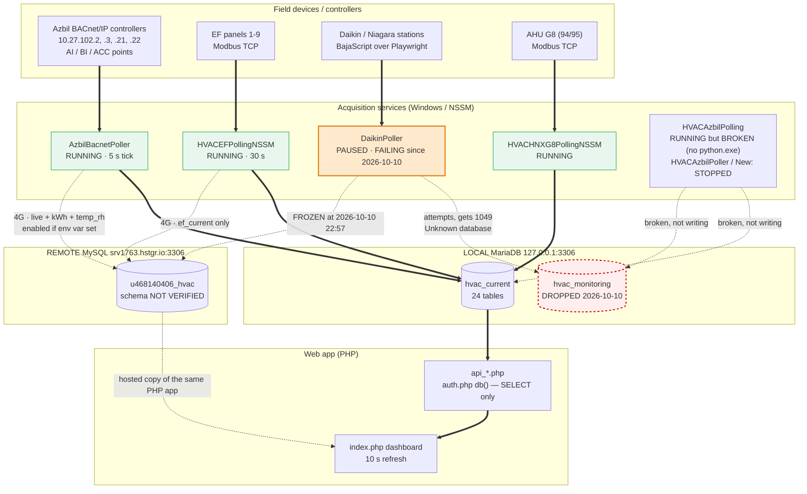

# Database Architecture & Data Flow — HVAC Monitoring

**Audit date:** 2026-10-11 · **Mode:** read-only
**Companion documents:** `DATABASE_INVENTORY.md` (objects/columns), `DATABASE_LOCAL_REMOTE_PARITY.md`,
`DATABASE_SECURITY_REVIEW.md`

> **Line convention in the diagram:** **solid** = verified from running services, live data freshness, and source
> code. **Dashed** = inferred or not verified by this audit. A dashed line is never drawn merely because two
> database names match.

---

## 1. System boundary

The project is **not one application**. It is:

- **one web app** (`C:\xampp\htdocs\hvac_monitoring`) — PHP, read-only against one database; and
- **several independent pollers**, each in its own project directory, each with its own service, its own
  credentials, and its own write targets.

The web app never writes operational data. Every live table is filled by a poller. This split is the single most
important structural fact about the system, and it is why a poller failure (the Daikin case, §6) shows up as
silently stale data rather than an error page.

---

## 2. Data-flow diagram



### Legend / reading notes

| Element | Status |
|---|---|
| `BAC → AzbilBacnetPoller → hvac_current` | **VERIFIED** — service Running; `ai_current`/`bi_current`/`acc_current` all stamped seconds ago |
| `EFDEV → HVACEFPollingNSSM → hvac_current.ef_current` | **VERIFIED** — `ef_current.last_update` is current |
| `HNXDEV → HVACHNXG8PollingNSSM → hvac_current.hnx_g8_current` | **VERIFIED** — `hnx_g8_current.last_update` is current |
| `NIA → DaikinPoller → hvac_monitoring` | **VERIFIED BROKEN** — 292 × error 1049; see §6 |
| Any `→ u468140406_hvac` | **NOT VERIFIED** — no remote credential available to this audit; see §7 |
| `hvac_current → api_*.php → index.php` | **VERIFIED** — API source read; single shared `db()` in `auth.php` |

---

## 3. Authoritative source per data domain

"Authoritative" = the only place the value is genuinely produced. Everything else is a copy.

| Domain | Authoritative source | Local table(s) | Remote copy | Notes |
|---|---|---|---|---|
| AHU status / duct temp | Azbil BACnet controllers | `points` + `ai_current`/`bi_current` | dashed (env-gated) | |
| HVAC SC (CHILLER/CCP/CHWP/CT) | Azbil BACnet controllers | `points` + `ai_current`/`bi_current` | dashed | incl. the `CHILLER n MODBUS` groups |
| Exhaust fans | EF panels (Modbus) | `ef_points` + `ef_current` | dashed (`ef_current` only) | |
| Room temp & RH (live) | Azbil BACnet controllers | `points` + `ai_current` | dashed | |
| Room temp & RH (history) | **poller snapshot** | `temp_rh_hourly` | dashed | Not reconstructable from `ai_current` (overwritten in place) |
| Daily energy | **poller snapshot of ACC meters** | `kwh_total_*` / `kwh_usage_*` | dashed | `kwh_usage_*` derived, not measured |
| Global alarms | **poller evaluation** | `alarm_events` | **no remote copy found** | Local-only event log |
| Daikin AHU | Niagara stations | `daikin_current` (+ `daikin_points` catalog) | dashed, **frozen** | Currently broken |
| AHU G8 | Modbus TCP | `hnx_g8_points` + `hnx_g8_current` | none found | Web app has **no reader yet** |
| Users / auth | manual administration | `users` | separate accounts by design | Not copied (avoids spreading hashes) |

**Two domains are "authoritative nowhere" in the usual sense:**

- `kwh_usage_*` is **derived**, not measured — it is `today's total − yesterday's total`. If a day's snapshot is
  missed, that day's usage is `NULL` forever (by design: the writer refuses to invent a number).
- `alarm_events` is an **evaluation log**, not device state. The device's own alarm point is authoritative; the
  poller's row is a derived event. `alarm_events` is also **local-only** — no remote writer was found for it, so
  the hosted dashboard's ALARM tab has no verified data source.

---

## 4. Copy vs independent write

| Relationship | Kind | Evidence |
|---|---|---|
| `hvac_current` ↔ `u468140406_hvac` | **Independent writes by the same poller** (dual-write), not replication | `azbil_bacnet/Program.cs` writes local then remote in separate transactions/connections |
| `ai_current` local vs remote | Same values, written twice ~30 s apart | remote copy is every 6th tick (`REMOTE_EVERY_N_TICKS = 6`) |
| `temp_rh_hourly` local vs remote | Same rows, separate inserts | `SaveHourlyTempRh` is called once per target |
| `alarm_events` | **Local only** — no remote path found | `grep REMOTE_CONN_STR` in the poller shows no alarm use |
| `ef_alarm_events` vs `alarm_events` | **Two different logs**, both real | EF-specific vs global; different schemas, different writers |
| `points` vs `daikin_points` vs `hnx_g8_points` | **Three separate catalogs** | Different columns; no FK or sync between them |

**No database-level replication, no triggers, no scheduled events exist.** Verified: 0 triggers, 0 routines,
0 events, `event_scheduler = OFF`. Every copy is application-driven.

**The matching database names are a trap.** `hvac_current` (local) and `u468140406_hvac` (remote) hold the same
*schema* by convention and are written by the same code, but this audit found **no synchronization mechanism** —
they are two independent write targets. A synchronization link is therefore drawn dashed, and the parity
document records `NOT VERIFIED` rather than asserting they match.

---

## 5. Request path in the web app (verified)

```
browser (index.php, 10 s poll)
   └─ api_*.php
        └─ require auth.php        → 401 JSON if no session
             └─ db()               → ONE static PDO, built from config.php
                  └─ SELECT …      → hvac_current
```

Every endpoint shares the same `db()` singleton in `auth.php`, so **the web app has exactly one database
identity**, configured in one place. `config.php` (gitignored) currently points at `127.0.0.1:3306 / hvac_current`
as `hvac_web`. Verified: the app is **unaffected by the `hvac_monitoring` drop**, because it never referenced it.

Endpoint → table map (verified from source):

| Endpoint | Reads |
|---|---|
| `api_ahu.php` | `points`+`ai_current`+`bi_current`, `threshold_direct`, `daikin_current` |
| `api_hvac_sc.php` | `points`+`ai_current`+`bi_current`, `threshold_direct`, `threshold_by_kw`, `unit_motor_kw` |
| `api_room.php` | `points`+`ai_current`, `threshold_direct`, `daikin_current` |
| `api_ef.php` | `ef_points`+`ef_current`, `daikin_current` |
| `api_alarm.php` | `alarm_events` |
| `api_energy.php` | `information_schema.columns` (column discovery) + `kwh_total_*`/`kwh_usage_*` |
| `api_temp_rh_hourly.php` | `temp_rh_hourly` |

**No endpoint reads** `ef_alarm_events`, `ef_communication_events`, `daikin_points`, `hnx_g8_points`, or
`hnx_g8_current`. Those tables currently have no consumer in the web app — see `DATABASE_INVENTORY.md` §6.

---

## 6. The Daikin failure — current architecture defect

This is the most significant live finding of the audit.

**Symptom.** `daikin_current.last_update` is frozen at **2026-10-10 22:57:28** (≈20 h stale at audit time),
while every other live table is current to the second.

**Cause (VERIFIED).** The Daikin poller still targets the deleted database:

- `C:\Projects\ahu_ef_daikin\ahu_poller_unified.py:374` → `"database": "hvac_monitoring"`
- `…:1205` → `INSERT INTO hvac_monitoring.daikin_readings …`
- Service `DaikinPoller` → **PAUSED** (Automatic start), running `ahu_poller_unified.py`
- Its log `_audit\daikin_poller_stderr.log` records the last successful write at `2026-10-10 22:57:30`
  ("wrote 38 readings, 38 current states") followed by **292 occurrences** of
  `pymysql.err.OperationalError: (1049, "Unknown database 'hvac_monitoring'")`, the most recent at 19:15:47.

**Why it did not stop the other data.** The other three pollers were each migrated to `hvac_current` and are
unaffected:

| Poller | Target DB now | Evidence |
|---|---|---|
| Azbil BACnet | `hvac_current` | `Program.cs` history write removed (commit `ad49d98`); runs `hvac_current.*` |
| EF | `hvac_current` | `ef_polling_engine_claude_v2.py` has zero `hvac_monitoring` refs (commit `deb638e`) |
| HNX G8 | `hvac_current` | `db.py` config; live data confirms |
| **Daikin** | **`hvac_monitoring` (deleted)** | **not migrated — still broken** |

So the user's report that "the poller was updated" is **correct for the Azbil/EF/HNX pollers but not for the
Daikin poller.** The Daikin poller is a *separate service* that was missed by that update.

**Effect on the web app (VERIFIED).** `api_ahu.php`, `api_room.php` and `api_ef.php` all read `daikin_current`
to add the Daikin AHU 96/97 room sources. Those cards therefore show the last value from
2026-10-10 22:57 — stale, with no error surfaced to the operator. This is a **silent-staleness** defect: the UI
cannot distinguish "poller frozen" from "value unchanged".

**Not remediated by this audit.** The audit is read-only; no code, service, or database was changed.
Recommended remediation is in §9.

---

## 7. Remote architecture — NOT VERIFIED

The remote side is documented but **not observed**:

| Claim | Source | Status |
|---|---|---|
| Remote DB is `u468140406_hvac` at `srv1763.hstgr.io:3306` | `PROJECT.md` §1, `DEPLOY_HOSTING.md` §1.2 | reported, not observed |
| Same schema as local, imported via `mysqldump --no-data` | `PROJECT.md` §1 | **NOT VERIFIED** |
| Poller dual-writes live values to remote | poller source (`SaveCurrentRemote`, `SyncPointsRemote`) | code VERIFIED; runtime NOT VERIFIED |
| Remote `temp_rh_hourly` and kWh tables written | poller source (`SaveHourlyTempRh`, `SaveDailyKwh`) | code VERIFIED; runtime NOT VERIFIED |
| Remote `alarm_events` | **no code found** | absent (local-only alarm log) |
| Remote `ef_*` | `ef_polling_engine_claude_v2.py` writes `ef_current` only | code VERIFIED; runtime NOT VERIFIED |
| Hosted web app uses user `u468140406_hvac` with **full privileges** | `DEPLOY_HOSTING.md` §1.2 | documented limitation of shared hosting |

**The remote database was not inventoried, not fingerprinted, and not compared.** See
`DATABASE_LOCAL_REMOTE_PARITY.md`.

---

## 8. Architecture risks identified

| # | Risk | Severity | Basis |
|---|---|---|---|
| R1 | **Daikin poller targets a dropped database** and is paused → silent stale data in 3 endpoints | **High** | §6 |
| R2 | **`alarm_events` has no remote copy**, so the hosted ALARM tab has no verified data source | **High** | §3, §7 |
| R3 | **A broken service (`HVACAzbilPolling`) is "Running"** and spamming a log with `No Python at …` | Medium | §2 of inventory; `azbil_project/logs/azbil_polling_engine.log` |
| R4 | **Three stale Azbil poller trees** on disk still name `hvac_monitoring` (`azbil_new2`, `azbil_project`, `unified_poller`); two have registered services (currently Stopped) | Medium | sweep report; `reg query` of service Parameters |
| R5 | **Live values are overwritten in place** — an outage is invisible after the fact and cannot be reconstructed | Medium | `ai_current` schema; `PROJECT.md` §11 |
| R6 | **167-hour gap in `temp_rh_hourly`** (in two runs: 2 h on 2026-10-01, then 165 h from 2026-10-01 13:00 to 2026-10-08 09:00) is permanently unfillable and is visible in the UI | Medium | inventory §4.6 |
| R7 | **`points` has no FK** to `*_current`, so orphans accumulate silently (14 present) | Low | inventory §7.1 |
| R8 | **Web app cannot detect stale data** (`read_at` is stored but never compared for freshness) | Medium | `api_*.php` return `read_at` but the UI does not threshold it |
| R9 | `test` schema grants are wide open (`PUBLIC` has CREATE/DROP/ALTER) — MariaDB default, not project-created | Low | `SHOW GRANTS` |
| R10 | **Empty 0-byte backup files** give a false sense of recoverability | Low | sweep report §5 |
| R11 | **`information_schema.TABLE_CONSTRAINTS` is privilege-filtered** for `hvac_web` (8 of 34 constraints visible, both FKs and the `alarm_events` CHECK hidden) — any audit or drift check built on it will silently under-report | Medium | inventory §4; parity §2.1 |

R1, R2 and R8 compound: data can go stale (R1), with no operator-visible signal (R8), and the alarm log that
might have flagged it is not mirrored (R2).

---

## 9. Recommended next actions (NOT performed — read-only audit)

Ordered by severity. None of these were executed.

1. **Migrate the Daikin poller off `hvac_monitoring`.** This is the same remediation already applied to the
   Azbil, EF and HNX pollers: point `MARIADB_CONFIG` at `hvac_current` and remove/relocate the
   `hvac_monitoring.daikin_readings` history insert (`ahu_poller_unified.py:374`, `:1205`). A prior Phase-1
   audit (`_audit/MIGRATE_TO_HVAC_CURRENT_AUDIT.md`) stopped at "migration blocked" and recorded two blockers:
   `daikin_readings` exists nowhere, and user `daikin_poller` lacks grants on `hvac_current.daikin_points`.
   **Both blockers need an owner decision before any change.**
2. **Decide the fate of `alarm_events` on the hosted site** — either add a remote writer, or accept that the
   hosted ALARM tab is local-only. Currently undocumented.
3. **Retire the broken/stale pollers** (`HVACAzbilPolling`, `HVACAzbilPoller`, `HVACAzbilPollerNew`, and the
   `azbil_new2` / `azbil_project` / `unified_poller` trees) so they cannot be started by accident against a
   database that no longer exists.
4. **Add a staleness indicator** using the `read_at` the APIs already return — this is what would have made the
   Daikin freeze visible. `PROJECT.md` §4 notes a timezone prerequisite for this.
5. **Verify remote parity** with a credential this audit did not have (see `DATABASE_LOCAL_REMOTE_PARITY.md`).
6. **Decide on the 14 orphan rows** (`PROJECT.md` §214 records the decision as open).

---

## 10. What is deliberately NOT in this architecture

- **No MariaDB Event Scheduler jobs.** `event_scheduler = OFF`; 0 events. History is poller-driven.
- **No triggers or stored routines.** 0 of each. All logic is in application code.
- **No views.** 0 views; the web app pivots long-format data in PHP instead.
- **No cross-database foreign keys.** The only FKs are within `hvac_current`
  (`ef_alarm_events → ef_points`, `hnx_g8_current → hnx_g8_points`).
- **No replication** between local and remote.
